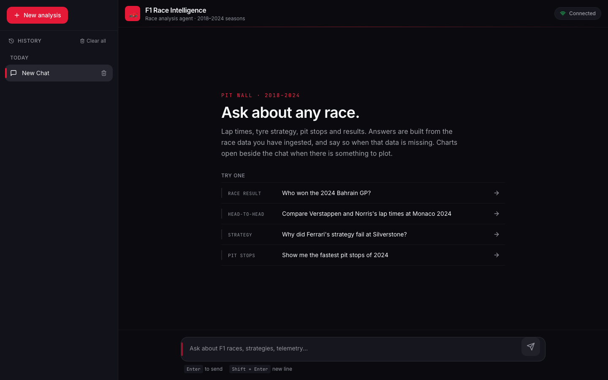
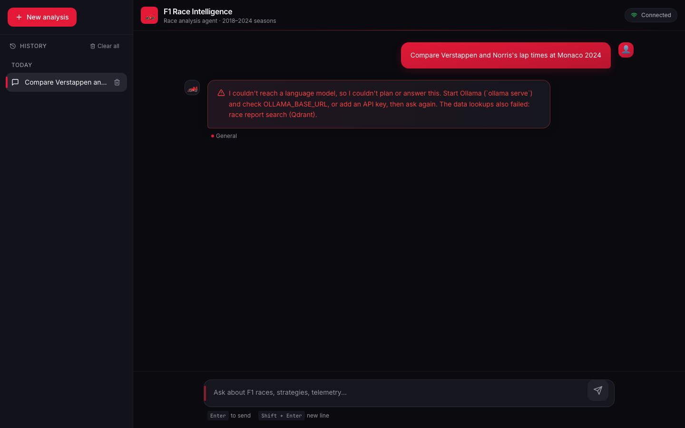

# F1 Race Intelligence Agent

Ask questions about Formula 1 races in plain English ("Compare Verstappen and Norris's lap
times at Monaco 2024") and get an answer built from lap, pit-stop and telemetry data, with a
chart beside the chat when there is something to plot. A LangGraph agent plans the lookup,
queries TimescaleDB, Neo4j and Qdrant, checks that it actually got data, and only then
writes the answer. When the data isn't there it says so instead of guessing.




## What it does

- **Natural-language race questions.** Lap times, stints and tyre strategy, pit stops,
  results, head-to-heads and what-if pit timing, for the seasons the ingestion pipeline
  covers (2018-2024 via FastF1).
- **Typo-tolerant entity resolution.** "verstapen at silverston" resolves to Max Verstappen
  at Silverstone before the agent runs, and the UI shows what it understood. Common words
  are not turned into names ("pit" is not Piastri); tests pin this for the example prompts.
- **No data, no answer.** If every data tool fails or comes back empty, the agent skips the
  generate step and replies with what failed (an unreachable database, an empty result, or
  an unreachable language model) instead of inventing numbers.

  
- **Charts beside the chat.** Answers that return plottable rows open a chart panel; past
  charts reopen from a "View chart" button on the answer.

## Measured result: tool-surface consolidation (79 → 8)

The agent grew to 79 narrow TimescaleDB tools, many near-duplicates ("lap times by driver",
"by stint", "by compound"). That costs context on every request and makes tool choice harder
for the model. `consolidated_tools.py` collapses them into 8 intent-level tools: 5
parameterized dispatchers (race analysis, driver stats, standings, comparisons, what-if) plus
3 standalone tools, with guarded read-only text-to-SQL for the long tail.

| | Before | After |
|---|---|---|
| TimescaleDB tools | 79 | **8** |
| Tool-schema tokens | 13,487 | **2,014** (−85%) |
| Underlying capabilities reachable | 79 | 79 |

- **Measured, not estimated:** both sets are serialized with LangChain's
  `convert_to_openai_tool` and counted with tiktoken
  ([`backend/eval/measure_consolidation.py`](backend/eval/measure_consolidation.py) →
  [`results/consolidation.json`](backend/eval/results/consolidation.json)).
- **Zero capability loss, enforced by a test:** `test_every_timescale_tool_is_covered_exactly_once`
  fails if any original function becomes unreachable or is covered twice.
- **Not yet bound at runtime.** The consolidated set is built and tested, but the running
  agent still registers the full set: 92 tools (79 TimescaleDB + 8 Neo4j + 5 vector search).
  Switching the binding needs the databases up to validate answers end to end.

Design notes: [`ENGINEERING_LOG.md`](ENGINEERING_LOG.md). Every number here has a row in
[`CLAIMS.md`](CLAIMS.md).

## Architecture

```
 Browser ── Next.js 14 chat UI (Zustand, Recharts/visx) ──── WebSocket /api/v1/chat/ws
                                                              │
 FastAPI ─ query preprocessor (fuzzy entity match, intent) ───┤  "Understood as" card
          │                                                   │  status updates, tokens
          ▼                                                   │
 LangGraph agent                                              │
   understand → plan → execute → process → evaluate ──┬─ enough data → enrich → generate → validate
        ▲           ▲                                 ├─ not enough  → plan again (max 2 rounds)
        │           └─────────────────────────────────┘
        │                                             └─ no usable data → "no data" reply (no LLM)
   LLM router: OpenAI → Groq → DeepSeek → Gemini → local Ollama (first one with a key wins)
          │
          ▼
 Data tools (92 bound)    TimescaleDB: laps, stints, pit stops, results (79 tools + text-to-SQL)
                          Neo4j: drivers, teams, circuits, race graph (8 tools)
                          Qdrant: race reports, regulations, past analyses (5 tools)
 Session state            Redis
 Ingestion (offline)      FastF1 → TimescaleDB + Neo4j (+ Qdrant content loaders)
```

**What runs today vs what is measured or optional**

| Piece | Status |
|---|---|
| Chat UI, WebSocket streaming, per-chat history in localStorage | Runs |
| Preprocessor (entity match, intent) and the agent graph above | Runs |
| No-data path (names the failed source, never generates) | Runs; covered by tests |
| Data-backed answers and charts | Need `make up` plus an ingest; see Quick start |
| 79 → 8 consolidated tools | Measured and tested; **not bound** at runtime |
| Qdrant RAG (race reports, regulations) | Tools are wired; needs content ingested into Qdrant |
| Long-term memory (Mem0) | Backend support exists; the UI sends no user id, so it is not used from the chat |
| Langfuse tracing, Sentry | Off unless their keys are set in `.env` |

## Quick start

### Docker (full stack)

```bash
git clone https://github.com/Pranav1011/F1-Race-Intelligence-Agent.git
cd F1-Race-Intelligence-Agent

make setup   # creates .env from .env.example, pulls images and the llama3.1:8b Ollama model
make up      # frontend :3000, API :8000 (/docs), Neo4j browser :7474

# Load one race first (the full 2018-2024 ingest takes hours)
make ingest-race YEAR=2024 ROUND=1
```

No API keys are needed: with none set, the agent runs on the local Ollama model. Add any of
`OPENAI_API_KEY`, `GROQ_API_KEY`, `DEEPSEEK_API_KEY` or `GOOGLE_API_KEY` to `.env` to use a
hosted model first; the router tries them in that order and falls back to Ollama.

### Without Docker (UI + agent, no race data)

Useful for working on the UI or the agent. Without the databases, every question ends in the
honest "couldn't reach the race data" reply.

```bash
ollama pull llama3.1:8b && ollama serve          # the backend defaults to localhost:11434

cd backend
uv venv && uv pip install -e ".[dev]"
.venv/bin/uvicorn api.main:app --port 8000      # first start ~1 min: loads the embedding model

cd ../frontend                                    # in a second terminal
pnpm install --frozen-lockfile && pnpm dev        # http://localhost:3000
```

### Tests

```bash
cd backend && .venv/bin/pytest          # or `make test` inside the running stack
cd frontend && pnpm type-check
```

The frontend uses pnpm, like the Makefile, Dockerfile and CI; `package-lock.json` is kept in
sync for `npm ci` users. The backend suite has 174 passing tests. `tests/test_api/test_health.py::test_health_check`
needs the Docker databases and fails without them.

## Design decisions and limitations

- **The agent checks for data before it writes.** An evaluate step scores what the tools
  returned. If every failure is an unreachable service it stops at once (re-planning can't
  revive a dead database, and each re-plan is a full LLM call); with no usable rows for other
  reasons it re-plans once. Either way it ends in a no-data reply that never calls the model.
  This was added after the agent produced plausible but invented pit tables with every
  database down.
- **Leaving stops the work.** If the browser disconnects mid-answer, the API cancels the
  agent instead of finishing an answer nobody will read.
- **Entity matching favours precision.** Fuzzy matches need 4+ characters and 0.85
  similarity, and a stopword list blocks words such as "at" (an AlphaTauri alias) or "pit".
  Some real typos ("perz") are therefore left for the model to interpret.
- **Years are read against the data, and the UI says so.** A follow-up with no year keeps the
  chat's previous year; otherwise no year means 2024, the last ingested season, and "this
  season" / "last season" count back from 2024, not the calendar year. The "Understood as"
  card shows any year the user didn't type. The remembered year lives in the API process.
- **One answer at a time.** The UI streams one answer across all chats; other chats show
  why sending is paused and keep the draft editable.
- **Local model quality.** llama3.1:8b sometimes returns a plan that isn't valid JSON; the
  planner then falls back to a default lookup. Hosted models plan more reliably.
- **No authentication.** The API and WebSocket are open; run it locally or behind your own
  auth.
- **Dark theme only.** The UI forces the dark palette; text tokens meet WCAG AA (4.5:1+) on
  every surface, and motion follows the OS "reduce motion" setting.

## Project structure

```
├── backend/
│   ├── api/              # FastAPI routes (HTTP + WebSocket)
│   ├── agent/            # LangGraph graph, nodes, LLM router, tools
│   ├── preprocessing/    # Fuzzy entity matching, intent, query expansion
│   ├── data/             # Driver, team and circuit lists used by the preprocessor
│   ├── ingestion/        # FastF1 → TimescaleDB / Neo4j / Qdrant
│   ├── memory/           # Redis session state, Mem0 long-term memory
│   ├── observability/    # Langfuse + Sentry hooks
│   ├── eval/             # Tool-cost measurement and results
│   └── tests/
├── frontend/             # Next.js app: app/, components/, stores/, hooks/
├── docs/plans/           # Design documents
└── docker-compose.yml
```

## Documentation

- [Architecture design](docs/plans/2025-12-14-f1-race-intelligence-agent-design.md)
- [Engineering log](ENGINEERING_LOG.md)
- [Claims and evidence](CLAIMS.md)

## License

MIT License - see [LICENSE](LICENSE) for details.

## Acknowledgments

- [FastF1](https://github.com/theOehrly/Fast-F1) for F1 data access
